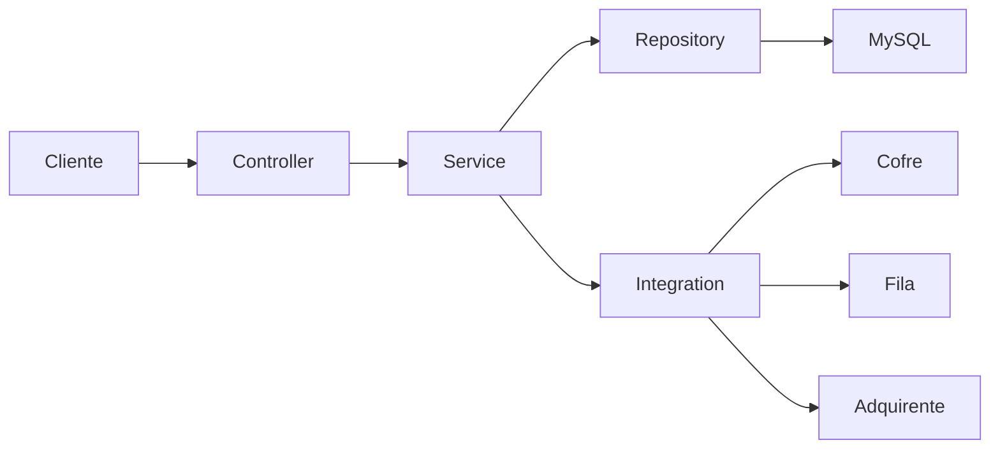
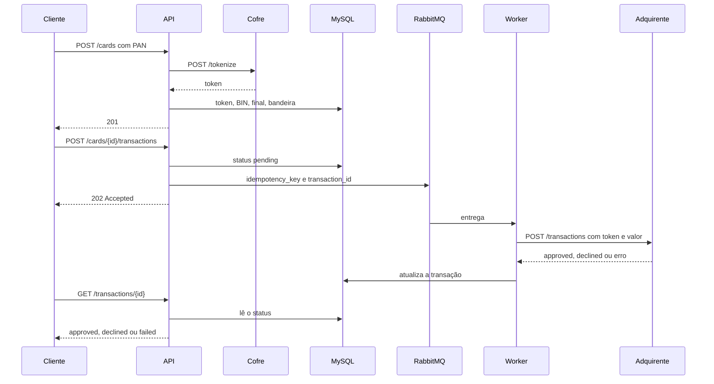

# cards-api

API didática em [Hyperf](https://hyperf.wiki) 3.2 para cadastrar cartões e cobrar em segundo plano. O código e os comentários estão em português; os identificadores ficam em inglês.

Ela existe para uma aula sobre três assuntos:

1. Camadas com uma responsabilidade cada.
2. A mesma porta de repositório em ORM e em Query Builder.
3. Uma cobrança assíncrona, com fila, retentativa e redução de escopo PCI por tokenização.

Não é um gateway de produção. As credenciais do `compose.yaml` são de laboratório.

## Subir

```bash
docker compose up -d --build --wait
make migrate
make seed
```

A API não migra sozinha. O entrypoint só espera MySQL e RabbitMQ, declara a topologia da fila e sobe o Hyperf.

| Serviço | Endereço no host | Para quê |
| --- | --- | --- |
| API | http://127.0.0.1:9501 | HTTP |
| Worker | sem porta publicada | consome a fila |
| MySQL 8.0 | 127.0.0.1:3306 | `cards` / `cards`, root `root` |
| RabbitMQ | 127.0.0.1:5672 | AMQP |
| Management UI | http://127.0.0.1:15672 | usuário `cards`, senha `cards` |
| Cofre (vault) | http://127.0.0.1:8081 | tokeniza o PAN |
| Adquirente (gateway) | http://127.0.0.1:8082 | aprova ou recusa |

Os mocks são um `server.php` com o servidor embutido do PHP. `ROLE=vault` ou `ROLE=gateway`. Não há API paga.

Atalhos no `Makefile`: `up`, `down`, `migrate`, `seed`, `test`, `logs`, `mode-orm`, `mode-qb`.

## O que é o Hyperf

O Hyperf roda em cima do [Swoole](https://openswoole.com/). O processo fica vivo e atende vários requests ao mesmo tempo com corrotinas: quando uma corrotina espera MySQL, HTTP ou RabbitMQ, outra continua. Não é uma thread por request e não é o modelo clássico do PHP-FPM, em que cada request sobe e morre.

Nesta API o servidor HTTP é `SWOOLE_BASE` na porta 9501. O worker é outro container do mesmo projeto, com `AMQP_CONSUMER_ENABLED=true`, para a aula ver o produtor e o consumidor separados.

Documentação usada aqui: [visão geral](https://hyperf.wiki/3.1/#/en/quick-start/overview), [model](https://hyperf.wiki/3.1/#/en/db/model), [query builder](https://hyperf.wiki/3.1/#/en/db/querybuilder), [AMQP](https://hyperf.wiki/3.1/#/en/amqp) e [Guzzle](https://hyperf.wiki/3.1/#/en/guzzle). O manual publicado ainda está no caminho `3.1`; os pacotes instalados são `~3.2.0`.

## Camadas



| Camada | O que faz | O que não faz |
| --- | --- | --- |
| `app/Controller` | HTTP, status, JSON | regra de bandeira, SQL, HTTP externo |
| `app/Request` | FormRequest do Hyperf | persistência |
| `app/Service` | Luhn, validade, bandeira, duplicidade, orquestração | saber se o repositório é Model ou `Db::table` |
| `app/Repository` | lê e grava | chamar cofre ou fila |
| `app/Integration` | Guzzle e AMQP atrás de interface | regra de negócio |
| `app/Model` | tabela, fillable, casts, `masked_number` | HTTP |

`CardService` depende de `CardRepositoryInterface`. A implementação troca em `config/autoload/dependencies.php` conforme `CARD_REPOSITORY`:

```bash
make mode-orm
make mode-qb
```

Isso recria só o container `app`. O worker continua no ORM de transação de propósito: a comparação ORM versus Query Builder fica nos cartões, para o fluxo da fila continuar legível.

## Request de cartão

`POST /cards` aceita o PAN só nesta chamada. O serviço:

1. valida Luhn e a validade (o cartão vale até o fim do mês de expiração);
2. tira o BIN (6 dígitos) e os 4 finais;
3. detecta a bandeira;
4. recusa duplicata ativa com o mesmo BIN, final e validade;
5. manda o PAN e a validade ao cofre;
6. descarta o número e grava token, BIN, final, bandeira e validade.

O BIN de 8 dígitos (IIN) existe no mundo real. Esta API persiste os 6 primeiros para o `masked_number` sair no formato `411111******1111`.

Ordem da bandeira em `CardBrandDetector`: Elo, Hipercard, Amex, Mastercard (51–55 e 2221–2720), Visa. Elo vem antes da Visa porque faixas como `401178` começam com 4 e não são Visa. A lista Elo é um subconjunto didático, não a tabela completa da bandeira.

CVV, CVC e `security_code` são recusados no FormRequest. Não existe coluna para eles.

## PCI: o cofre simula o CDE

O [PCI DSS](https://www.pcisecuritystandards.org/standards/pci-dss/) trata o ambiente em que o PAN trafega ou é armazenado como CDE (*cardholder data environment*). Tokenização, quando o PAN fica só no cofre, é uma forma clássica de [tirar componentes do escopo](https://www.pcisecuritystandards.org/faq/articles/Frequently_Asked_Question/how-can-tokenization-be-used-to-reduce-the-number-of-components-for-which-pci-dss-requirements-apply/).

Nesta aula o container `vault` faz o papel do CDE:

- a API envia o PAN por HTTP e recebe um `tok_...`;
- o MySQL guarda token, BIN, final e bandeira;
- a fila não leva PAN nem token, só `idempotency_key` e `transaction_id`;
- o worker lê o token da linha da transação e manda isso ao adquirente.

O arquivo do cofre (`/data/store.json` no volume) é o único lugar que persiste o número inteiro. BIN e final continuam sendo dados de cartão truncados: ajudam suporte e roteamento, e mesmo assim são tratados com cuidado.

Limite honesto desta simulação: o `POST /cards` ainda recebe o PAN para encaminhá-lo. Um QSA olharia esse processo como em escopo, porque o número passou pela memória do PHP. Em produção a redução de escopo de verdade usa campos hospedados (hosted fields) ou um SDK do cofre, para o PAN nunca entrar neste processo. O mock isola o armazenamento. Não certifica a aplicação.

## Query Builder e ORM

Os dois repositórios cumprem `CardRepositoryInterface`. O serviço não muda.

O ORM (`CardOrmRepository`) usa o Model. `SoftDeletes` coloca `deleted_at IS NULL` sozinho, timestamps e o accessor `masked_number` vêm do Model.

O Query Builder (`CardQueryBuilderRepository`) usa `Db::table('cards')`. Timestamps são preenchidos na mão, toda leitura precisa de `whereNull('deleted_at')`, o soft delete é um `UPDATE`, e a máscara chama `Card::mask()`.

Trechos da listagem:

```php
// ORM
$query = Card::query()->orderByDesc('id');
$query->where('brand', $brand);
$paginator = $query->paginate($perPage, ['*'], 'page', $page);
```

```php
// Query Builder
$query = Db::table('cards')->whereNull('deleted_at')->orderByDesc('id');
$query->where('brand', $brand);
$paginator = $query->paginate($perPage, ['*'], 'page', $page);
```

SQL real, copiado de `runtime/logs/sql.log` com `DB_QUERY_LOG=true` (29/10/2026, fuso America/Sao_Paulo).

ORM, filtro por bandeira e soft delete:

```text
[2026-10-29 14:27:16] [0.37ms] select count(*) as aggregate from `cards` where `brand` = 'visa' and `cards`.`deleted_at` is null
[2026-10-29 14:27:16] [0.19ms] select * from `cards` where `brand` = 'visa' and `cards`.`deleted_at` is null order by `id` desc limit 1 offset 0
[2026-10-29 14:27:16] [0.51ms] update `cards` set `deleted_at` = '2026-10-29 14:27:16', `cards`.`updated_at` = '2026-10-29 14:27:16' where `id` = '10'
```

Query Builder, o mesmo tipo de operação. O `deleted_at` aparece porque o repositório escreveu `whereNull`:

```text
[2026-10-29 14:29:10] [0.49ms] select count(*) as aggregate from `cards` where `deleted_at` is null and `brand` = 'mastercard'
[2026-10-29 14:29:10] [0.38ms] select * from `cards` where `deleted_at` is null and `brand` = 'mastercard' order by `id` desc limit 1 offset 0
[2026-10-29 14:29:10] [1.25ms] update `cards` set `deleted_at` = '2026-10-29 14:29:10', `updated_at` = '2026-10-29 14:29:10' where `id` = '11' and `deleted_at` is null
```

O insert do ORM deixa o Model preencher `updated_at` e `created_at` e qualifica a tabela (`cards.deleted_at`). O Query Builder manda as colunas na ordem do array PHP e repete o `whereNull` no `UPDATE` do delete.

| | ORM | Query Builder |
| --- | --- | --- |
| Leitura | parece o domínio | o SQL fica explícito |
| Soft delete | o trait faz | fácil esquecer um `whereNull` |
| Troca de banco | o grammar esconde diferenças | você vê o SQL do MySQL |
| Performance | um objeto por linha | linha crua, menos alocação |
| Nesta aula | bom para a regra do cartão | bom para mostrar o SQL |

Não há índice único parcial no MySQL para “um cartão ativo”. A duplicata é regra do serviço e ignora linha com `deleted_at` preenchido. Por isso o mesmo PAN pode ser cadastrado de novo depois do delete.

## Síncrono e assíncrono

Chamar o adquirente dentro do `POST` prenderia o cliente no tempo de rede, no timeout e na retentativa. A fila separa “aceitei o pedido” de “o adquirente respondeu”.



Por que uma fila, e não uma chamada HTTP no mesmo request:

- o cliente recebe 202 assim que o pedido está durável no MySQL e no broker;
- o worker pode cair e a mensagem continua na fila;
- timeout e HTTP 500 do adquirente viram retentativa, sem o browser esperando;
- dá para colocar mais de um consumidor depois, sem mudar o contrato do `POST`.

O cliente HTTP é Guzzle via `hyperf/guzzle`, atrás de `VaultClientInterface` e `GatewayClientInterface`. Timeout de 2 segundos. Até 3 tentativas em exceção de rede e HTTP 5xx, com uma pausa curta. 4xx não retenta.

### Regras do adquirente simulado

O valor é em centavos. O final dos centavos decide:

| Final | Efeito |
| --- | --- |
| `99` | HTTP 200, `declined`. Não retenta: é resposta de negócio. |
| `77` | HTTP 500 sempre. O worker retenta e, no limite, manda para a DLQ. |
| `66` | espera `GATEWAY_SLOW_MS` (4s) e responde 500. O timeout do cliente é 2s. |
| outro | `approved` |

A mesma `idempotency_key` no adquirente devolve a resposta já gravada, inclusive o 500.

### Retentativa, DLQ e idempotência

`TRANSACTION_MAX_ATTEMPTS` vale 3. Erro técnico incrementa `attempts` e o consumidor devolve a mensagem à fila (`Result::REQUEUE`). Na última tentativa o worker marca `failed`, publica na dead-letter queue e dá ACK, para a mensagem não ser morta duas vezes.

A fila `card.transactions` também tem `x-dead-letter-exchange` (`cards.dlx` → `card.transactions.dlq`). Isso pega reject e queda do processo. Ninguém consome a DLQ: a mensagem fica visível em http://127.0.0.1:15672.

Idempotência: se o status já é `approved`, `declined` ou `failed`, o worker não chama o adquirente de novo. Recusa não é falha técnica.

Referências: [AMQP no Hyperf](https://hyperf.wiki/3.1/#/en/amqp), [RabbitMQ](https://www.rabbitmq.com/) e [dead letter](https://www.rabbitmq.com/docs/dlx).

## Endpoints

```bash
curl -s http://127.0.0.1:9501/health

curl -s -X POST http://127.0.0.1:9501/cards \
  -H 'content-type: application/json' \
  -d '{"holder_name":"Ada Lovelace","number":"4111111111111111","expiry_month":12,"expiry_year":2030}'

curl -s 'http://127.0.0.1:9501/cards?brand=visa&per_page=2'
curl -s http://127.0.0.1:9501/cards/1
curl -s -X PUT http://127.0.0.1:9501/cards/1 \
  -H 'content-type: application/json' \
  -d '{"holder_name":"Ada Lovelace"}'
curl -s -X PATCH http://127.0.0.1:9501/cards/1 \
  -H 'content-type: application/json' \
  -d '{"expiry_month":11,"expiry_year":2031}'
curl -s -o /dev/null -w '%{http_code}\n' -X DELETE http://127.0.0.1:9501/cards/1

curl -s -X POST http://127.0.0.1:9501/cards/1/transactions \
  -H 'content-type: application/json' \
  -d '{"amount":10.00}'

curl -s http://127.0.0.1:9501/transactions/1
```

`amount` é em reais. A tabela guarda centavos inteiros (`10.00` vira `1000`). Para ver a recusa, use `10.99`. Para ver a DLQ, use `10.77`.

As saídas reais destes fluxos estão em [docs/RESULTS.md](docs/RESULTS.md).

## Testes

```bash
make test
```

O alvo migra `cards_testing` e roda o PHPUnit duas vezes, com `CARD_REPOSITORY=orm` e `CARD_REPOSITORY=query_builder`. Os testes de serviço usam falsos no lugar do cofre, do adquirente e da fila. Os testes HTTP usam MySQL, o cofre e o RabbitMQ de verdade. O worker aponta para o banco `cards` e ignora mensagem cujo `idempotency_key` não existe lá, então a suíte não corrompe a demonstração.

O `co-phpunit` executa dentro de uma corrotina, e `pcntl_fork` não funciona nesse contexto. O bootstrap dos testes varre as anotações com `ProcScanHandler`.

## Layout

```text
app/Controller        HTTP
app/Service           regras
app/Repository        ORM e Query Builder
app/Integration       cofre, adquirente, fila
app/Amqp              produtor, consumidor, JSON
docker/mocks          vault e gateway
```
